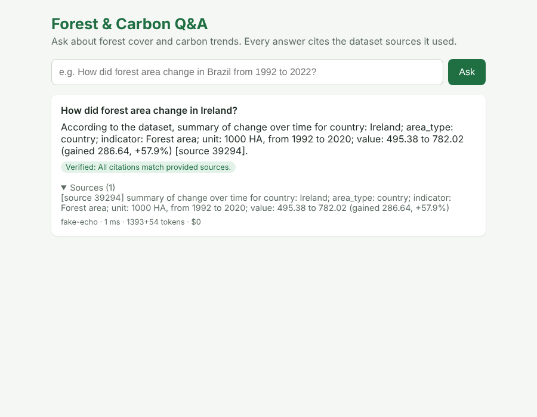
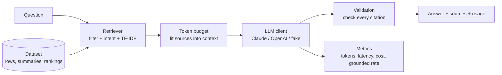

# Forest & Carbon Q&A

A small retrieval-augmented (RAG) chatbot that answers questions about forest area and forest carbon stocks for 235 countries and regions (1992–2020) by calling an LLM API (Claude or OpenAI). Every answer cites the data it used, and the app checks those citations before showing the answer.

Built as a companion to my MSc project [Forest and Carbon Explorer](https://d00274214-shruthi-proddutur.shinyapps.io/forest-and-carbon-explorer/).



## What it shows

| Skill | Where in the code |
|---|---|
| Calling LLM APIs in code | `app/llm.py`: Claude and OpenAI adapters behind one interface |
| Token management | `app/prompt.py`: retrieved context is trimmed to a token budget; output length is capped |
| Latency and cost tracking | Every call records exact token counts, latency and estimated cost; `GET /metrics` reports KPIs |
| Data preparation | `scripts/prepare_data.py`: reshapes the wide FAO dataset (one column per year) into one fact per row |
| RAG pipeline | `app/retriever.py`: metadata filtering, question-intent ordering and TF-IDF ranking over 40,010 sources |
| Validating AI output | `app/validation.py`: flags answers with no citations or citations to data the model never saw |
| API + web interface | `app/main.py` (FastAPI) and `app/static/index.html` (HTML, CSS, JavaScript) |
| Testing | `tests/`: 26 pytest tests on the real data, including a "hallucinating" model and a failing provider |
| Docker and CI/CD | `Dockerfile` and `.github/workflows/ci.yml`: tests, image build and a container smoke test on every push |

## How it works



1. **Retrieve.** The dataset becomes 40,010 short text "sources":
   - 38,657 rows, one fact each ("Ireland, Forest area, 2010: 720.38 thousand ha")
   - 1,333 summaries, one per country and indicator (first vs last year, with % change)
   - 20 rankings of the largest gains and losses, by absolute and % change, with countries and regional groups ranked separately

   Countries, indicators and units named in the question filter the sources ("China" also matches the official name "China, P.R.: Mainland"). "How did X change" questions get summaries first, "which lost the most" questions get rankings first, and TF-IDF orders the rest.
2. **Budget.** Sources are added in relevance order until `MAX_CONTEXT_TOKENS` is reached, which keeps cost and latency predictable.
3. **Generate.** The prompt tells the model to use only the sources given and to cite each figure as `[source N]`.
4. **Validate.** The app checks that every cited source was actually sent. Answers with no citations, or invented ones, are labelled "Check this" in the UI instead of "Verified".
5. **Measure.** `/metrics` reports requests, errors, average and p95 latency, tokens, estimated cost and grounded-answer rate.

## Run it

### 1. Locally (Python 3.12)

```bash
python -m venv .venv
source .venv/bin/activate          # Windows: .venv\Scripts\activate
pip install -r requirements-dev.txt

# Offline mode: no API key needed
uvicorn app.main:app --reload
# open http://localhost:8000
```

To use Claude, copy `.env.example` to `.env`, add your key, then:

```bash
export LLM_PROVIDER=anthropic
export ANTHROPIC_API_KEY=sk-ant-...      # from console.anthropic.com
uvicorn app.main:app --reload
```

For OpenAI, set `LLM_PROVIDER=openai` and `OPENAI_API_KEY` instead. `LLM_MODEL` overrides the default model.

### 2. With Docker

```bash
docker build -t forest-carbon-chatbot .
docker run -p 8000:8000 -e LLM_PROVIDER=anthropic -e ANTHROPIC_API_KEY=sk-ant-... forest-carbon-chatbot
```

### 3. Tests

```bash
pytest -q
```

Tests use an offline fake model, so they run in CI without an API key.

## Data

Source: Food and Agriculture Organization of the United Nations (FAO), 2022. FAOSTAT Land, Inputs and Sustainability, Land Use (http://www.fao.org/faostat/en/#data/RL); IMF staff calculations. Accessed 28 March 2023.

- `data/raw/forest_carbon_cleaned.csv`: the cleaned dataset from my MSc project (wide format, F1992–F2020)
- `data/forest_carbon_long.csv`: the prepared file the app loads. Rebuild it with `python scripts/prepare_data.py`

Indicators: forest area (1000 ha), carbon stocks in forests (million tonnes), share of forest area (%), land area, and indices of forest extent and carbon stocks. Regional and economic groups (World, G20, Africa ...) are labelled `regional group`, so rankings compare countries with countries.

The loader works with any long-format CSV: if it has a `year` column and text columns such as `country`, summaries and rankings are built automatically.

## Settings

| Variable | Default | Purpose |
|---|---|---|
| `LLM_PROVIDER` | `fake` | `anthropic`, `openai` or `fake` |
| `LLM_MODEL` | per provider | e.g. `claude-haiku-5-5` |
| `DATA_PATH` | `data/forest_carbon_long.csv` | Dataset to load |
| `MAX_CONTEXT_TOKENS` | 1500 | Budget for retrieved sources |
| `MAX_OUTPUT_TOKENS` | 400 | Cap on answer length |
| `TOP_K` | 25 | Sources retrieved before budgeting |
| `REQUEST_TIMEOUT_S` | 30 | Give up on slow provider calls |
| `COST_PER_MTOK_INPUT` / `_OUTPUT` | 0 | USD per million tokens, from your provider's pricing page |

## Design decisions and trade-offs

- **TF-IDF instead of embeddings.** No vector database or extra API calls, and it is easy to inspect. The limitation: it matches exact words, so "European" does not match "Europe". The next step is embeddings with a vector store; `Retriever` is the only class that would change.
- **Metadata filtering.** Plain TF-IDF ranked rare tokens (years) above countries, so "Ireland in 2010" returned other countries' 2010 rows. Filtering on values named in the question fixed this, and a test guards it.
- **Summaries and rankings.** A question like "which country lost the most forest?" would need all 235 series in the prompt. Precomputing rankings keeps it to one source and a few hundred tokens.
- **Groups vs countries.** World and G20 first topped the "lost the most" ranking. Labelling aggregates separately fixed this.
- **Citation check, not blind trust.** LLMs can invent figures. Requiring `[source N]` citations makes every number traceable and lets the app flag unsupported answers automatically.
- **Provider abstraction.** The app only calls `LLMClient.complete()`. Switching Claude to OpenAI is a config change, and tests swap in fake, failing and hallucinating models.
- **Estimated vs exact tokens.** Budgeting uses a fast estimate (about 4 characters per token) before the call; metrics use the exact counts the provider returns.

## Next steps

- Embeddings-based retrieval and a small evaluation set to measure answer accuracy
- An agent (LangGraph) that can compute aggregates such as averages across countries
- Streaming responses and response caching for repeated questions
